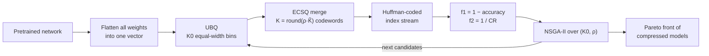

[Code](https://github.com/rkhosrowshahi/EvoDeepQuantization) · [Earlier preprint (arXiv)](https://arxiv.org/abs/2501.03095) · [All publications]({{ '/publications/' | relative_url }})

## TL;DR

A trained network is mostly a long list of 32-bit floats. Weight sharing stores it more cheaply: a small **codebook** of shared values, plus, for every weight, the index of the codeword it uses. The usual recipe builds the codebook layer by layer with K-means, fine-tunes it afterwards, and judges the result by how few codewords it needs.

In our paper, accepted to _IEEE Transactions on Big Data_ [[1]](#references), we skip all of that. **UB-ECSQ-NSGA2** flattens every weight into one vector, bins it on a uniform grid, merges neighboring bins with an exact dynamic program that anticipates what Huffman coding will charge, and lets NSGA-II search just two numbers. There is no retraining, no gradient, and no use of the architecture: the same code compresses ResNets, VGG16-BN and a Vision Transformer.

Within a 1% drop in accuracy, the compression ratio (CR) reaches 20.8 on CIFAR-10, 10.4–12.3 on the ImageNet ResNets, 18.4 on VGG16-BN and 9.0 on ViT-B/16. In each setting that is higher than every baseline we evaluated. The code is on [GitHub](https://github.com/rkhosrowshahi/EvoDeepQuantization).

The most useful lesson is not about the search at all:

> When the indices are entropy coded, the number of codewords is the wrong thing to minimize.

---

## Weight sharing in one paragraph

Take a network with $N$ weights. Weight sharing replaces them by $K \ll N$ shared values, the **codewords**, and stores for each weight the index of its codeword. The codebook costs $32K$ bits. The index stream costs $\lceil \log_2 K \rceil$ bits per weight if every index has the same width. If the indices are Huffman coded [[2]](#references), codeword $i$ gets a code of $b_i$ bits and

$$
\text{CR} = \frac{32\,N}{32\,K + \sum_{i=1}^{K} b_i\,\lvert C_i \rvert},
$$

where $\lvert C_i \rvert$ is the number of weights that share codeword $i$. With $N$ in the millions and $K$ in the hundreds, the codebook is negligible. **The index stream is the model.**

Deep Compression [[3]](#references) made this recipe popular: prune, cluster each layer's weights with K-means, retrain the shared values, then Huffman code the indices.

---

## Three habits worth questioning

Most weight-sharing pipelines share three habits.

1. **Per-layer codebooks.** K-means costs $O(NKTR)$ for $T$ iterations and $R$ restarts, and it has to be refit for every $K$. To stay tractable, it is run layer by layer. That needs the layer boundaries and tensor shapes, which a model released as a black box does not expose. It also turns the choice of $K$ into one choice per layer, a search space that grows exponentially with depth. Dupuis _et al._ [[4]](#references) tame it with a two-level search.
2. **Retraining.** Fine-tuning the shared values recovers accuracy, but it is a second, expensive optimization whose budget is not known in advance.
3. **Counting codewords.** $K$ is swept over powers of two, because a fixed-width index costs $\lceil \log_2 K \rceil$ bits, and fewer codewords is read as more compression.

UB-ECSQ-NSGA2 drops all three.

---

## Step 1: one vector, equal-width bins

Flatten every weight of the network (everything except biases) into a single vector. No layer boundaries, tensor shapes or channel counts are used. Cut the range of that vector into $K_0$ equal-width bins, shifted so that zero sits exactly at the center of a bin. Represent every occupied bin by **the mean of the weights that fell into it**, and drop the empty bins, leaving $\tilde K \le K_0$ codewords.

This is **Uniform Binning Quantization (UBQ)**. It takes one pass over the weights, $O(N)$, for any $K_0$, so trying a new bin count costs nothing like refitting K-means. The zero anchoring matters because most trained weights sit near zero. The bin containing zero holds the largest share of them, and centering it keeps its mean near zero for every $K_0$.

Equal-width bins look naive next to K-means, which places its codewords where the weights are. Yet UBQ alone, with no merging and no search, already has a larger hypervolume than global K-means in all eight of our settings. The next section explains why.

---

## Step 2: count bits, not codewords

Here are three codebooks for ResNet-18 on CIFAR-10. All three keep about 94.8% calibration accuracy (the uncompressed model scores 95.10%):

| Codebook                            | Codewords | Accuracy | Stored bits per weight |   CR |
| ----------------------------------- | --------: | -------: | ---------------------: | ---: |
| K-means, $K = 128$                  |       128 |   94.78% |                   5.28 |  6.1 |
| UBQ, $K_0 = 256$                    |       175 |   94.84% |                   2.16 | 14.8 |
| UB-ECSQ, $K_0 = 255$, $\rho = 0.64$ |       112 |   94.82% |                   1.57 | 20.4 |

UBQ uses _more_ codewords than K-means and stores the network in 2.4 times fewer bits. Figure 1 shows why.

<div class="row mt-3">
  <div class="col-sm mt-3 mt-md-0">
    
  </div>
</div>
<div class="caption">
  Figure 1. Share of the 11.2M weights that use each codeword, sorted from the most to the least used, for the three codebooks in the table. The vertical axis is logarithmic; the floor is a single weight.
</div>

K-means places its codewords to minimize squared error, so it spends them where the weights are dense. The crowded region around zero gets split among many codewords, and each one ends up serving a modest share of the weights. Its most-used codeword holds only 4.6% of the weights, and it takes 41 codewords to cover 90% of them. A flat occupancy like this is the worst case for Huffman coding, because almost every index needs a long code.

Equal-width bins do the opposite. The single bin around zero holds 50% of all weights, five bins cover 90%, and 151 of the 175 bins hold less than 0.01% each. An index used that often gets a one-bit Huffman code, and the long codes go to the rare tail bins. Merging (Step 3) pushes this further: after it, one codeword holds 69% of the weights and three cover 90%.

So the stored size is governed by the **entropy of the occupancy**, not by the number of codewords. Entropy-constrained quantization [[5]](#references) is built on exactly this observation, and it is what the next step exploits.

---

## Step 3: merge neighbors, exactly

After UBQ, many neighboring bins are close to redundant: two bins with nearly the same mean, or a tail bin holding a handful of weights. Merging two of them changes two things. It adds squared error, because the merged weights now share one value. It also changes the rate, the entropy of the occupancy, which is what Huffman coding pays.

**Entropy-Constrained Scalar Quantization (ECSQ)** picks a partition $\pi$ of the $\tilde K$ ordered bins into contiguous groups that minimizes

$$
J(\pi) = \mathrm{SE}(\pi) + \lambda\, R(\pi).
$$

Both terms add up over groups and depend only on each bin's count $n_b$ and mean $c_b$. With prefix sums $M_j = \sum_{b \le j} n_b$, $S_j = \sum_{b \le j} n_b c_b$ and $T_j = \sum_{b \le j} n_b c_b^2$, merging bins $i+1$ through $j$ costs

$$
\mathrm{SE}_{i+1:j} = (T_j - T_i) - \frac{(S_j - S_i)^2}{M_j - M_i},
\qquad
R_{i+1:j} = -(M_j - M_i)\log_2 \frac{M_j - M_i}{N}.
$$

Because the groups are contiguous, a dynamic program finds the exact optimum:

$$
\mathrm{dp}_j = \min_{0 \le i < j} \; \mathrm{dp}_i + \mathrm{SE}_{i+1:j} + \lambda R_{i+1:j}.
$$

It runs in $O(\tilde K^2)$, which is microseconds for a few hundred bins. It needs no forward pass, no data and no gradient.

Sweeping $\lambda$ over a grid yields a **merge ladder**: one partition for every codebook size the trade-off can reach. The search never picks $\lambda$ directly. It asks for $K = \max(1, \mathrm{round}(\rho \tilde K))$ codewords, so $\rho = 1$ means no merging, and takes the nearest rung of the ladder.

---

## Step 4: search two numbers

A candidate compressed model is fully described by $x = (K_0, \rho)$: two variables, however large the network.



Evaluating a candidate takes four steps:

1. Bin the weights at $K_0$.
2. Take the rung of the merge ladder closest to $\rho \tilde K$.
3. Run one forward pass over a held-out calibration split of 5,000 images, which gives $f_1 = 1 - \text{accuracy}$.
4. Run one Huffman pass, which gives $f_2 = 1/\text{CR}$.

NSGA-II [[6]](#references), as implemented in pymoo [[7]](#references), evolves a population of 100 candidates for 10 generations on CIFAR and 15 on ImageNet. The result is not a single model but a Pareto front: you pick the point that fits your memory or accuracy budget.

The range of $K_0$ is not tuned by hand either. A short warm-up bisects $\log_2 K_0$ with UBQ alone and sets two edges:

- **The aggressive edge** is the largest $K_0$ that still loses more than 50% of the accuracy. It sits deliberately on the bad side of the accuracy cliff, so that the search can still reach very compressed points just past it.
- **The other edge** is the smallest $K_0$ that loses at most 0.5%.

For ResNet-18 on CIFAR-10, this gives $K_0 \in [64, 256]$. The whole CIFAR search takes about half an hour on one GPU.

---

## Results

We compared against six baselines on the same checkpoints and calibration splits, with no pruning and no fine-tuning anywhere:

- **K-means** in the style of Deep Compression [[3]](#references), with one global codebook.
- **Uniform Quantization, Hessian-weighted K-means and Iterative ECSQ** from Choi _et al._ [[8]](#references).
- **GPTQ** [[9]](#references).
- **The layer-wise search of Dupuis _et al._** [[4]](#references).

<div class="row mt-3">
  <div class="col-sm mt-3 mt-md-0">
    
  </div>
</div>
<div class="caption">
  Figure 2. Calibration accuracy against compression ratio, zoomed to the region near the uncompressed accuracy. The blue line is the median over five search seeds of the best accuracy reachable at each CR, and the band spans the best and worst seed. Baselines connect their evaluated points in order of CR. Iterative ECSQ is left out for readability: its only accurate point has a CR of about 4.
</div>

The table gives the compression ratio within a 1% accuracy drop, as in the paper's Tables I–III:

| Dataset · model       | Uncompressed acc. | Best baseline          |  UB-ECSQ-NSGA2 |
| --------------------- | ----------------: | ---------------------- | -------------: |
| CIFAR-10 · ResNet-18  |            95.10% | 16.4 (Dupuis _et al._) | **20.8** ± 0.3 |
| CIFAR-100 · ResNet-18 |            76.66% | 12.7 (Dupuis _et al._) | **12.9** ± 0.2 |
| ImageNet · ResNet-18  |            69.58% | 8.6 (Uniform Quant.)   | **10.5** ± 0.1 |
| ImageNet · ResNet-34  |            73.46% | 9.0 (Uniform Quant.)   | **10.9** ± 0.1 |
| ImageNet · ResNet-50  |            76.34% | 8.0 (Uniform Quant.)   | **10.4** ± 0.1 |
| ImageNet · ResNet-101 |            77.12% | 9.7 (Hessian K-means)  | **12.3** ± 0.0 |
| ImageNet · VGG16-BN   |            72.92% | 16.8 (Dupuis _et al._) | **18.4** ± 0.1 |
| ImageNet · ViT-B/16   |            80.76% | 8.6 (Hessian K-means)  |  **9.0** ± 0.0 |

Over the whole front, UB-ECSQ-NSGA2 has the highest hypervolume in all eight settings. It does not win every cell, though. Across the 48 accuracy targets of Tables I–III it gives the highest CR in 43. The exceptions are:

- Dupuis _et al._ at the two tightest CIFAR-100 targets.
- Dupuis _et al._ on VGG16-BN at 2% and 5% drops.
- Uniform Quantization at the tightest ResNet-34 target.

GPTQ deserves a separate note. It stores fixed-width integer codes, so it never exploits a skewed occupancy and never reaches the highest CR at any target. Its 2-bit points keep between 15% and 61% accuracy on the ImageNet CNNs. But it buys something UB-ECSQ does not: faster integer arithmetic at inference time.

---

## What it does not do

- **It saves storage and transmission, not compute.** The compressed model must be Huffman-decoded and its codewords looked up before inference.
- **It needs a labeled calibration split** and one forward pass per candidate.
- **Results vary more across architectures than across depths.** Within a 1% drop, the CR ranges from 9.0 on ViT-B/16 to 18.4 on VGG16-BN, but only from 10.4 to 12.3 across the ResNets. The bin width is set by the extreme weights, so our conjecture is that large outliers hurt the transformer. Clipping or separately storing them is the natural next experiment, and a first step toward language models, where such outliers are common.
- **It does not prune.** Pruning composes with it, since a sparse network is still a vector of numbers, but we have not measured the combination.

---

## Try it

```bash
git clone https://github.com/rkhosrowshahi/EvoDeepQuantization.git
cd EvoDeepQuantization
pip install -r requirements.txt
python main.py --config configs/cifar10/resnet18/seed1.yaml
```

This downloads CIFAR-10 and the pretrained checkpoint, runs the search, and writes `final_pareto_front.csv`, one compressed model per row. Every setting and seed in the paper has its own config, and every baseline runs with one command. The [README](https://github.com/rkhosrowshahi/EvoDeepQuantization#readme) has the details.

---

## References

1. Khosrowshahli, R., Rahnamayan, S., & Ombuki-Berman, B. (2026). A Structure-Agnostic Multi-Objective Evolutionary Weight-Sharing Compression Framework for Deep Neural Networks. _IEEE Transactions on Big Data_ (accepted). [Code](https://github.com/rkhosrowshahi/EvoDeepQuantization) · [earlier preprint](https://arxiv.org/abs/2501.03095).
2. Huffman, D. A. (1952). [A Method for the Construction of Minimum-Redundancy Codes](https://doi.org/10.1109/JRPROC.1952.273898). _Proceedings of the IRE_, 40(9), 1098–1101.
3. Han, S., Mao, H., & Dally, W. J. (2016). [Deep Compression: Compressing Deep Neural Networks with Pruning, Trained Quantization and Huffman Coding](https://arxiv.org/abs/1510.00149). _ICLR 2016_.
4. Dupuis, E., Novo, D., O'Connor, I., & Bosio, A. (2022). A Heuristic Exploration of Retraining-Free Weight-Sharing for CNN Compression. _ASP-DAC 2022_. [Code](https://github.com/e-dupuis/retraining-free-weight-sharing).
5. Chou, P. A., Lookabaugh, T., & Gray, R. M. (1989). [Entropy-Constrained Vector Quantization](https://doi.org/10.1109/29.17498). _IEEE Transactions on Acoustics, Speech, and Signal Processing_, 37(1), 31–42.
6. Deb, K., Pratap, A., Agarwal, S., & Meyarivan, T. (2002). [A Fast and Elitist Multiobjective Genetic Algorithm: NSGA-II](https://doi.org/10.1109/4235.996017). _IEEE Transactions on Evolutionary Computation_, 6(2), 182–197.
7. Blank, J., & Deb, K. (2020). [pymoo: Multi-Objective Optimization in Python](https://doi.org/10.1109/ACCESS.2020.2990567). _IEEE Access_, 8, 89497–89509.
8. Choi, Y., El-Khamy, M., & Lee, J. (2017). [Towards the Limit of Network Quantization](https://arxiv.org/abs/1612.01543). _ICLR 2017_.
9. Frantar, E., Ashkboos, S., Hoefler, T., & Alistarh, D. (2023). [GPTQ: Accurate Post-Training Quantization for Generative Pre-trained Transformers](https://arxiv.org/abs/2210.17323). _ICLR 2023_.
